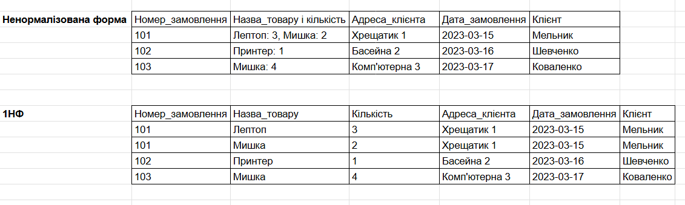
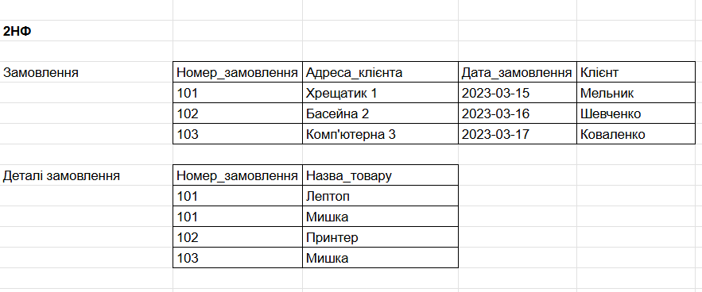
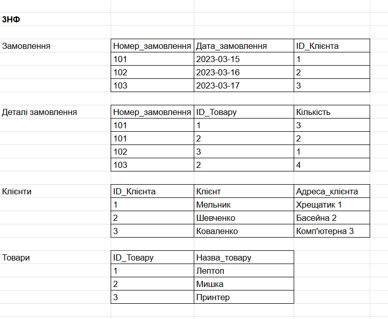
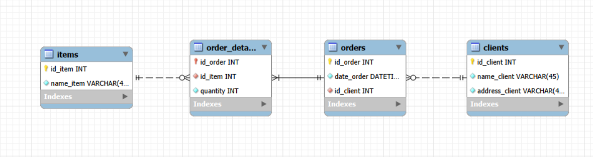
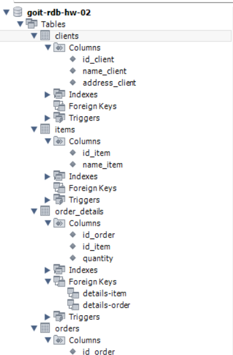
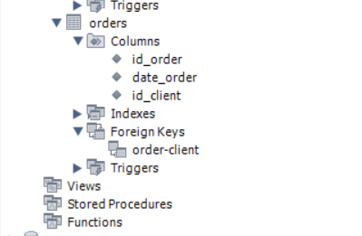

# goit-rdb-hw-02: Database design using semantic models

Репозиторій містить виконання домашнього завдання №2 з реляційних баз даних: нормалізація даних, семантичне проєктування ER-моделі та реалізація схеми в MySQL Workbench.

---

## 1. Нормалізація даних

* **Онлайн-документ нормалізації:** [Google Sheets — Процес нормалізації](https://docs.google.com/spreadsheets/d/1jmoAbDQJx0AvPX5i_CO0iuIOpvg8dAagKEj9xlyefqw/edit?usp=sharing)

### Етапи перетворення:
1. **Перша нормальна форма (1NF):** 
   * Усунено списки в одній комірці (розбито складні поля «Назва_товару і кількість» на окремі атомарні атрибути `Назва_товару` та `Кількість`).
   * Визначено складений первинний ключ.
   
   

2. **Друга нормальна форма (2NF):**
   * Винесено атрибути, які частково залежали від первинного ключа. Створено окремі таблиці замовлень та деталей замовлення.
   
   

3. **Третя нормальна форма (3NF):**
   * Усунено транзитивні функціональні залежності (винесено клієнтів в окрему сутність `clients`, а товари — в `items`).
   * Отримано кінцеву структуру з чотирьох таблиць: `clients`, `orders`, `order_details`, `items`.
   
   

---

## 2. Фізична EER-діаграма

Спроєктована EER-модель із визначеними типами даних, первинними (`PK`) та зовнішніми (`FK`) ключами, а також правильно налаштованими кардинальностями (`1:M`, обов'язковість зв'язків):

* Файл моделі MySQL Workbench: [`goit-rdb-hw-02.mwb`](goit-rdb-hw-02.mwb)

---

## 3. Схема в базі даних (MySQL Workbench)

Створена база даних та розгорнута структура таблиць зі стовпцями й зовнішніми ключами:

* 
* 

---

## Структура репозиторію

* `goit-rdb-hw-02.mwb` — файл проєкту моделі MySQL Workbench.
* `ER_Diagram.png` — експортована ER-діаграма зв'язків.
* `p1_1NF.png`, `p2_2NF.png`, `p3_3NF.png` — скриншоти таблиць нормалізації (1NF, 2NF, 3NF).
* `Schema_1.png`, `Schema_2.png` — скриншоти розгорнутої структури схеми в MySQL Workbench.
* `README.md` — опис виконаного завдання.
